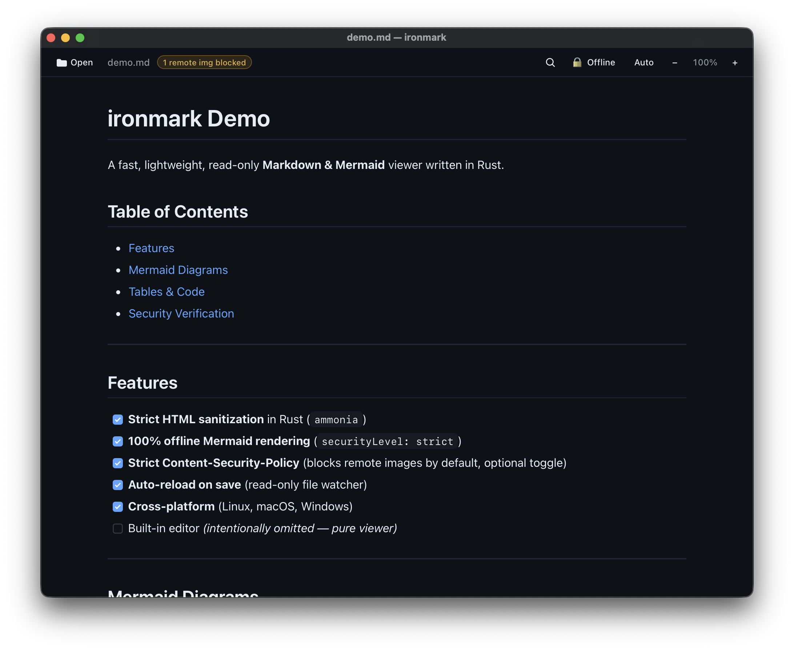

# ironmark

**A fast, secure, read-only Markdown viewer with fully offline Mermaid support.**

[](https://github.com/kevinfra/ironmark/actions/workflows/ci.yml)
[](https://github.com/kevinfra/ironmark/releases)
[](LICENSE)




Written in Rust, no Electron, no editor. Open a `.md` file and read it.

## Quick start

```bash
brew install kevinfra/tap/ironmark   # macOS; see "Installation" for other platforms
ironmark README.md
```

## Features

- **Instant and lightweight**: uses your OS native WebView instead of bundling a browser.
- **Full Markdown support**: CommonMark + GFM (tables, task lists, footnotes, strikethrough).
- **Mermaid diagrams, 100% offline**: bundled in the binary, no CDN. Click a diagram to expand and zoom.
- **Live reload**: updates automatically when the file changes on disk, keeping your scroll position.
- **Light / Dark mode**: follows the system theme, with a manual `Auto` / `Light` / `Dark` switch.
- **Easy to open files**: from the terminal, by drag & drop, or with `Cmd/Ctrl + O`.
- **Private by default**: remote images are blocked unless you opt in (see [Security](#security)).

## Installation

| Platform | Command |
| :--- | :--- |
| **macOS** | `brew install kevinfra/tap/ironmark` |
| **Linux / Windows / macOS** | Download a prebuilt binary from [GitHub Releases](https://github.com/kevinfra/ironmark/releases) |
| **From source** | `cargo install --git https://github.com/kevinfra/ironmark` (see [Build from source](#build-from-source)) |

## Usage

```bash
ironmark README.md                  # open a file
ironmark --allow-remote README.md   # also load remote http(s) images
ironmark                            # empty window: drag & drop or press Cmd/Ctrl+O
```

Want to try it right away? Open the bundled demo: `ironmark examples/demo.md`.

### Keyboard shortcuts

| Shortcut | Action |
| :--- | :--- |
| `Cmd/Ctrl + O` | Open `.md` file |
| `Cmd/Ctrl + F` | Find in document |
| `Cmd/Ctrl + R` | Reload manually |
| `Cmd/Ctrl + +` / `-` / `0` | Zoom in / out / 100% |
| `Cmd/Ctrl + Q` | Quit |
| `Esc` | Close search or diagram modal |

## Security

ironmark is designed to be safe to open untrusted Markdown files:

- **Strict sanitization** with `ammonia`: strips `<script>`, `<iframe>`, `<svg>`, `<style>`, `<form>`, `on*` attributes, and `javascript:` / `vbscript:` / `file:` / `data:` URLs.
- **Custom `ironmark://` protocol**: no local network ports are opened. A strict `Content-Security-Policy` is enforced (`script-src 'self'`, `object-src 'none'`, `frame-src 'none'`).
- **Safe local images**: relative images are served only from inside the document directory (canonical path check, no path traversal) with `Content-Security-Policy: sandbox`.
- **Controlled navigation**: navigation inside the WebView is blocked. `http(s)://` and `mailto:` links open in your system browser, and relative links to other `.md` files open in ironmark.
- **Offline by default**: remote images are blocked in both sanitization and CSP. Enable them with `--allow-remote` or the **Offline** button in the top bar.
- **Mermaid** runs with `securityLevel: 'strict'`.

## Build from source

<details>
<summary>System requirements</summary>

- **macOS**: Xcode Command Line Tools (`WKWebView` is included in the OS).
- **Windows**: MSVC toolchain + WebView2 Runtime (included in Windows 10/11).
- **Linux**: GTK 3 and WebKitGTK:
  - Debian / Ubuntu:
    ```bash
    sudo apt install libgtk-3-dev libwebkit2gtk-4.1-dev libsoup-3.0-dev
    ```
  - Fedora:
    ```bash
    sudo dnf install gtk3-devel webkit2gtk4.1-devel libsoup3-devel
    ```
  - Arch Linux:
    ```bash
    sudo pacman -S gtk3 webkit2gtk-4.1
    ```

</details>

```bash
cargo build --release
```

The binary is placed at `target/release/ironmark` (`target\release\ironmark.exe` on Windows).

## Contributing

Contributions are welcome. See [CONTRIBUTING.md](CONTRIBUTING.md) for instructions on building, running tests, and submitting pull requests.

## License and third-party notices

`ironmark` is distributed under the [MIT](LICENSE) license.

Third-party license notices (including the offline Mermaid bundle with version and SHA-256 hash) are documented in [THIRD_PARTY_NOTICES.md](THIRD_PARTY_NOTICES.md).
