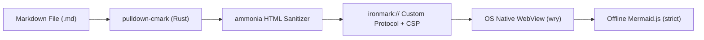
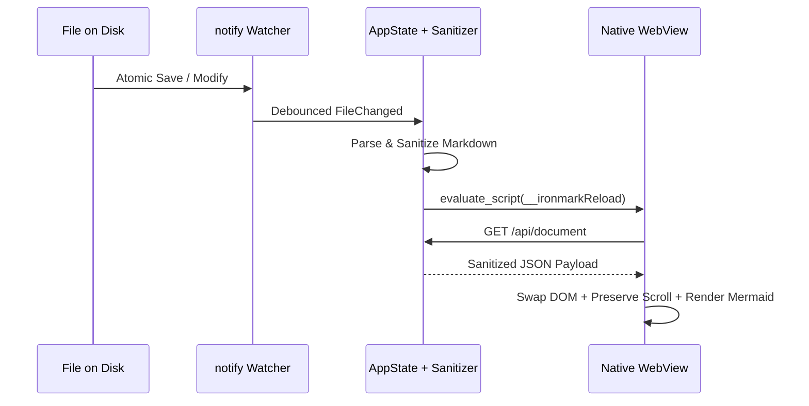
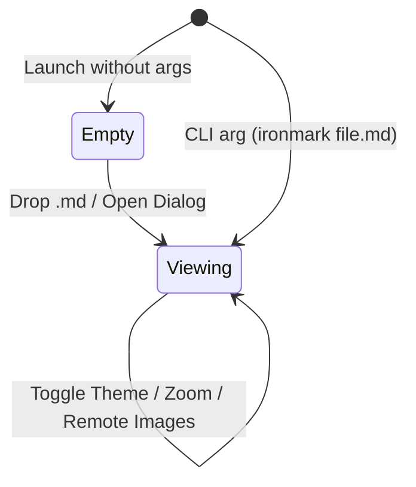

# ironmark Demo

A fast, lightweight, read-only **Markdown & Mermaid** viewer written in Rust.

## Table of Contents

- [Features](#features)
- [Mermaid Diagrams](#mermaid-diagrams)
- [Tables & Code](#tables--code)
- [Security Verification](#security-verification)

---

## Features

- [x] **Strict HTML sanitization** in Rust (`ammonia`)
- [x] **100% offline Mermaid rendering** (`securityLevel: strict`)
- [x] **Strict Content-Security-Policy** (blocks remote images by default, optional toggle)
- [x] **Auto-reload on save** (read-only file watcher)
- [x] **Cross-platform** (Linux, macOS, Windows)
- [ ] Built-in editor *(intentionally omitted — pure viewer)*

---

## Mermaid Diagrams

> Click any rendered diagram to expand and zoom it in full screen.

### Architecture Flowchart



### Live-Reload Sequence



### State Machine



---

## Tables & Code

| Layer | Mechanism | Goal |
| :--- | :--- | :--- |
| Parser | `pulldown-cmark` | Fast CommonMark + GFM |
| Sanitizer | `ammonia` | Strip `<script>`, `on*`, `javascript:`, `<iframe>` |
| Transport | `ironmark://` custom protocol | Zero open localhost ports |
| Policy | HTTP `Content-Security-Policy` | `script-src 'self'`, offline by default |
| Diagrams | Embedded gzipped `mermaid.min.js` | Full Mermaid support, 100% offline |

```rust
fn main() {
    println!("Fast, safe, read-only Markdown!");
}
```

---

## Security Verification

The following malicious HTML/Markdown snippets are embedded intentionally in this document.
If `ironmark` is working safely, **none** of them execute and all dangerous tags/handlers are stripped:

<script>alert("XSS-1: script tag should never execute")</script>


<svg onload="alert('XSS-3: svg onload should be stripped')"><circle r="10"/></svg>

<iframe src="https://example.com"></iframe>

<div onclick="alert('XSS-4: onclick should be stripped')">This text is safe; its <code>onclick</code> handler was removed.</div>

[Blocked javascript: link](javascript:alert('XSS-5'))

Remote image test (blocked by default in Offline mode; toggle **Offline** in the top bar to test enabling remote images):


